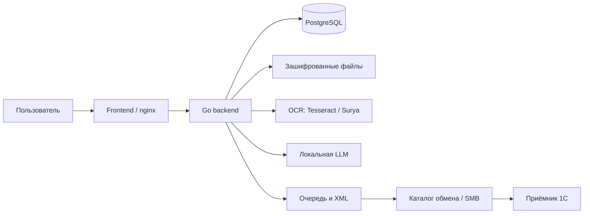

# Архитектура DocFlow

React/Vite интерфейс в [`docflow-frontend/src`](../docflow-frontend/src) предоставляет загрузку, карточки документов и администрирование; nginx проксирует API к backend. Go-приложение [`docflow/cmd/server`](../docflow/cmd/server) запускает HTTP API, миграции и фоновые обработчики. Правила доступа и обработчики находятся в [`internal/httpapi`](../docflow/internal/httpapi), доменные состояния — в [`internal/domain/models.go`](../docflow/internal/domain/models.go).

PostgreSQL хранит пользователей, метаданные, распознанные данные, состояния и задания; исходные файлы хранятся отдельно в [`internal/filestore`](../docflow/internal/filestore) с AES-256-GCM. Такое разделение позволяет работать с записями и очередями в БД, не помещая в неё сами файлы; для восстановления необходимы обе части и соответствующий ключ. Миграции — в [`internal/storage/migrations`](../docflow/internal/storage/migrations).

## Распознавание и маршрутизация

[`internal/worker/recognizer.go`](../docflow/internal/worker/recognizer.go) забирает документы из БД, при необходимости разделяет файл, запускает [`internal/recognize/pipeline.go`](../docflow/internal/recognize/pipeline.go), сохраняет результат и ставит задание экспорта. Подготовка включает преобразование PDF и изображений; OCR может использовать Tesseract, Surya или поддерживаемый конфигурацией альтернативный сервис. Правила, геометрия текста и таблиц и опциональная OpenAI-совместимая LLM извлекают и проверяют поля. [`surya-ocr`](../surya-ocr) содержит сервис Surya; Compose предусматривает локальный llama.cpp. Локальное размещение OCR и модели позволяет обрабатывать документы в инфраструктуре заказчика; фактический адрес модели задаётся конфигурацией и сам по себе не гарантирует локальность.

[`effective_doctype.go`](../docflow/internal/recognize/effective_doctype.go) объединяет семь внутренних типов в `act`, остальные сохраняет. Отдельный этап сохраняет специализированные правила распознавания и проверки исходного типа, предоставляя более короткий набор бизнес-категорий. Порядок маршрутизации различается между `legacy` и `type_inbox`; нельзя считать категории взаимозаменяемыми в бухгалтерском смысле.

Очереди распознавания и экспорта используют PostgreSQL и `FOR UPDATE SKIP LOCKED` для параллельных воркеров ([`documents.go`](../docflow/internal/storage/documents.go), [`export.go`](../docflow/internal/storage/export.go)). Выгрузка выполняется отдельным [`exporter.go`](../docflow/internal/worker/exporter.go), повторяя ошибки с растущей задержкой до лимита. Отделение экспорта от OCR позволяет повторять доставку независимо от распознавания. Подробности маршрутов и ограничений — в [INTEGRATION_1C.md](INTEGRATION_1C.md).

## Развёртывание и защита

Корневые [`docker-compose.yml`](../docker-compose.yml) и [`docker-compose.override.yml`](../docker-compose.override.yml) описывают БД, backend, frontend и профили AI/веб-доступа. Конфигурация, включённые профили и внешние сетевые службы определяют фактическую топологию. Backend не публикует порт напрямую в базовом Compose.

Пароли хешируются, доступ к API защищён JWT, роли и область видимости проверяются на сервере, действия аудируются; оригиналы шифруются на диске. Токен обратного канала 1С отдельный. См. [`internal/auth`](../docflow/internal/auth), [`middleware.go`](../docflow/internal/httpapi/middleware.go), [`handlers_scope.go`](../docflow/internal/httpapi/handlers_scope.go). TLS, ограничения CORS, секреты и права на файлы зависят от развёртывания.

При проверке развёртывания использовались публичный веб-доступ через Cloudflare Tunnel и отдельный приватный технический доступ через Tailscale. Разделение ограничивает экспозицию административных и файловых сервисов, но эти внешние службы не доказываются Compose и требуют проверки на конкретном сервере. SMB и SSH имеют собственную аутентификацию и права; наличие приватной сети не заменяет их.

## Подробный путь документа

| Этап | Реализация и результат | Условие или остановка |
| --- | --- | --- |
| Приём | [`handlers_documents.go`](../docflow/internal/httpapi/handlers_documents.go) проверяет размер, тип и компанию, сохраняет зашифрованный файл и создаёт запись `received`. | Неверный формат, права, ошибка файлов или БД возвращают ошибку API. |
| Захват | [`documents.go`](../docflow/internal/storage/documents.go) переводит запись в `processing`; воркер [`recognizer.go`](../docflow/internal/worker/recognizer.go) забирает её. | Ошибка БД мешает обработке; после внезапного прерывания восстановление зависших состояний следует проверять отдельно. |
| Разделение | Воркер вызывает проверку разделения; при нескольких частях создаёт отдельные записи для дальнейшей обработки. | Если разделение не удалось, воркер журналирует ошибку и продолжает исходный документ. |
| Подготовка и OCR | [`pipeline.go`](../docflow/internal/recognize/pipeline.go) расшифровывает файл во временную область, готовит страницы и вызывает OCR. | Ошибка подготовки, OCR или отсутствие текста приводят к `failed`. |
| Извлечение | Правила определяют тип и поля, геометрия и несколько кандидатов помогают разобрать таблицу. Включённая LLM вызывается, когда правилам не хватает уверенности, обязательных полей или подходящей таблицы. | При отключённой модели используются доступные правила; результаты нуждаются в проверке. |
| Проверка и категория | Проверяются обязательные поля исходного типа, затем `EffectiveDocType` приводит тип к бизнес-категории. При несоответствии сумм строки помечаются как отсутствующие для экспорта. | Порядок нормализации относительно выбора маршрута различается между профилями. |
| Маршрут | Воркер сохраняет результат и выбирает проверку, дополнение, согласование или подтверждение по профилю и настройкам. Ручные действия выполняются через API. | Неизвестный тип, выключенная автовыгрузка и другие условия могут потребовать человека. |
| Выгрузка | Подтверждение или соответствующий автоматический маршрут создаёт `export_jobs`; [`exporter.go`](../docflow/internal/worker/exporter.go) формирует payload и вызывает транспорт. | Ошибки повторяются до лимита; файловый XML и его публикация описаны в [интеграции](INTEGRATION_1C.md). |

## Состояния документа, задания экспорта и результата 1С

Это три независимых уровня, а не единый автомат. В частности, `exported` может быть установлен без подтверждения 1С и даже при отключённом транспорте.

| Документ | Значение и дальнейшее действие |
| --- | --- |
| `received`, `processing` | Ожидает обработки / захвачен воркером. После обработки сохраняется результат или ошибка. |
| `needs_review` | Требуется проверка и разрешённое ручное действие; например, не определён тип или выключен автоэкспорт. |
| `needs_input` | Требуются поля; после дополнения возможна повторная выгрузка. Частичный экспорт зависит от настройки. |
| `needs_approval` | Ожидает согласования главбуха в применимом сценарии `legacy`; согласование или отклонение меняет дальнейший маршрут. |
| `rejected` | Отклонён при согласовании; требуется дальнейшая работа пользователя. Это не одноимённый ответ 1С. |
| `confirmed` | Подтверждён для экспорта; наличие этого статуса не доказывает доставку. |
| `exported` | Экспортёр вернул успех для полного задания; не доказывает чтение файла или проведение. |
| `failed` | Ошибка распознавания; возможна повторная обработка через предусмотренный API. |

В [`export.go`](../docflow/internal/storage/export.go) новое задание `pending` захватывается как `sending`; успех даёт `done`, ошибка возвращает его в `pending` с задержкой либо переводит в `failed` после лимита. Вид `create`, `partial` или `update` — отдельный атрибут, не статус. Возможность автоматического восстановления зависшего `sending` после аварии по этим переходам не доказана.

Ответы 1С `accepted`, `posted`, `rejected`, `error` хранят результат обработки на стороне 1С, поступивший через отдельный API. Их отсутствие не позволяет заключить, что документ не был обработан. Параметры архивирования и контракт — в [INTEGRATION_1C.md](INTEGRATION_1C.md).

## Профили маршрутизации

| Условие | `legacy` | `type_inbox` |
| --- | --- | --- |
| Категория и каталог | Исходный тип проверяется до нормализации; файловая выгрузка использует папку компании или корень. | Проверка обязательных полей исходного типа предшествует нормализации; каталог выбирается по допустимой бизнес-категории. |
| Автовыгрузка выключена | `needs_review`. | `needs_review`. |
| Неизвестный тип | Проверка человеком. | Проверка человеком; неразрешённый тип блокируется и при построении XML. |
| Поля и mapping | При включённой проверке mapping его отсутствие направляет на проверку; недостающие поля и ошибки влияют на маршрут, в том числе через настройки частичной выгрузки. | Допустимый тип может быть подтверждён и без заполненных полей или mapping; XML отмечает неполноту. Это не гарантия пригодности для 1С. |
| Согласование | Учитываются настройки компании и автопропуска; ошибки могут направить документ на проверку. | Старые проверки ошибок и согласования в этом участке воркера обходятся. |
| Владелец | Учётная запись `golden_test` направляется на проверку; при ошибке поиска владельца поведение отличается от нового профиля. | Неопределённый владелец направляется на проверку; перед экспортом владелец и запрет `golden_test` проверяются повторно. |
| Частичный экспорт | Задание `partial` создаётся только при включённом `EXPORT_PARTIAL_ENABLED` и соответствующем статусе. | Неполный `create` возможен в автоматическом маршруте; `partial` также допускается только при соответствующем состоянии и настройках. |
| Ошибка публикации | Повтор до лимита; файловое переименование может заменить существующий путь в зависимости от ОС. | Повтор до лимита, но запрещённый payload отклоняется сразу; несовпадающий файл не перезаписывается. |

Причина отличия — разные правила маршрутизации, а не степень уверенности OCR. `type_inbox` выделяет пять папок для обмена и сохраняет XML-контракт. Безопасность обработки неполных данных принимающей стороной требует отдельного согласования.

## Основания решений и доступ

Локальные OCR/LLM ограничивают передачу содержимого за пределы инфраструктуры при локально настроенных URL, но требуют ресурсов и сопровождения моделей. Разделение БД и файлов упрощает работу с метаданными и очередями, однако требует согласованной копии обоих хранилищ и ключа. Шифрование уменьшает риск раскрытия файлов на диске, но потеря ключа делает копии нечитаемыми. Фоновые очереди позволяют повторять экспорт независимо от OCR, ценой необходимости контролировать зависшие и неуспешные задания. Отдельная нормализация сохраняет правила исходных типов, но объединённый тип не позволяет восстановить исходный класс.

Файловый XML отделяет DocFlow от логики учётной базы и подходит для обмена через общий каталог; при этом контроль прав, повторов и приёма ложится на обе стороны. Разделение публичного веб-доступа и приватного технического доступа уменьшает внешнюю экспозицию; это обоснование инфраструктуры, а не доказательство её текущего состояния.

Сервер проверяет JWT и роль; область документов определяется также принадлежностью и назначениями компаний. Клиент видит свои загрузки, главбух — назначенные компании, администратор — все. Оператор без компании видит все документы, тогда как привязанный ограничен своей компанией ([`handlers_scope.go`](../docflow/internal/httpapi/handlers_scope.go)); это существенное исключение для администрирования прав. Аудит сохраняет действия, но не заменяет проверку доступа. Обратный канал 1С использует отдельный токен, не пользовательскую сессию.

## Распознавание, LLM и финансовые поля

Вход в конвейер — `ProcessFor` и `processPath` в [`pipeline.go`](../docflow/internal/recognize/pipeline.go): файл временно расшифровывается, страницы подготавливаются, выполняется OCR, восстанавливается порядок слов и определяется текст зон. `RecognizeDocumentZoned` применяет правила типа и реквизитов; параллельно формируются кандидаты таблицы из раскладки, координат и сетки. При пустом OCR обработка завершается ошибкой. Конечные результаты и текст сохраняет воркер; маршрут экспорта принимается после этого по правилам профиля.

`needsModel` вызывает LLM, если тип неизвестен или недостаточно уверен, не хватает обязательных полей либо таблица выглядит неполной/подозрительной. [`refine_split.go`](../docflow/internal/recognize/refine_split.go) строит раздельные запросы реквизитов и, при необходимости, таблицы: `fieldSchemaMap`, `buildFieldsPrompt`, `buildTablePrompt`, `refineSplit`. Это инструкции и ожидаемый JSON в тексте запроса, а не гарантия строгого исполнения сервером. `modelExtract`, `modelLine`, `modelTable` в `pipeline.go` задают разбираемые структуры; [`model.go`](../docflow/internal/recognize/model.go) отправляет запрос и `decodeJSONObject` извлекает JSON, в том числе из ответа с ограждением. Если оба запроса не удались, остаётся результат правил; при частичном успехе объединяются доступные части.

При объединении непустые поля модели обычно заменяют кандидатов правил; неподходящий банковский номер и неизвестный счёт отбрасываются, а тип разрешается отдельно через `ResolveDocType`. Геометрическая и модельная таблицы сравниваются по оценке качества, а не всегда выбираются по одному источнику. После объединения `FixFields`, `PreferBlankNumber`, `FillTotalsFromTable`, `FillAmounts`, `ResolveParties`, `ApplyAccounts`, `ApplyConfidence`, проверки форматов и `DecideAutoPass` уточняют результат. Значение в OCR не гарантирует реквизит: оно может не попасть в нужную зону или схему, не быть возвращено моделью, потеряться при разборе или быть отклонено валидацией. Например, `amount_no_vat` отсутствует в `fieldSchemaMap`; его наличие в итоговых данных зависит от других механизмов, а не только от OCR.

Для диагностики сопоставляйте оригинал и OCR, зоны, кандидаты правил и таблиц, запрос/ответ модели, результат до и после постобработки, `source`, `confidence`, `missing`, `faults`, `review` и выбранный профиль. [`trace.go`](../docflow/internal/recognize/trace.go) и точки записи в `pipeline.go` помогают локализовать потерю, но трассы могут содержать реальные документы и промпты; храните их как чувствительные данные.

### Таблица и арифметика

[`table.go`](../docflow/internal/recognize/table.go) определяет роли колонок и переводит таблицу в позиции; разбор может присоединять продолжения многострочного наименования. [`quality.go`](../docflow/internal/recognize/quality.go) очищает и оценивает кандидатов (`CleanFreeTable`, `ScoreFreeTable`, `PickBestFreeTable`); [`table_repair.go`](../docflow/internal/recognize/table_repair.go) содержит ограниченную перестановку числовых ячеек с проверкой согласованности. Извлечённые количество, цена, сумма и НДС зависят от распознанной роли колонки; нормализация чисел и арифметика помогают оценить результат, но не доказывают исходное значение. Отдельные операции могут вычислять производные суммы — их происхождение необходимо учитывать при проверке.

Три дополнительные проверки в `pipeline.go` отключены по умолчанию: `FINANCIAL_TABLE_RECONCILE_ENABLED` включает `ReconcileGroundedSingleLineAmounts` для ограниченного случая одной позиции; `FINANCIAL_EVIDENCE_RECOVERY_ENABLED` включает `RecoverFinancialTotalsFromEvidence`, ищущий подтверждённые сочетания текста и таблицы; `FINANCIAL_CONFIDENCE_GUARD_ENABLED` включает `ApplyFinancialConfidenceGuard`. Последний не меняет суммы: при недостатке независимых подтверждений он снижает confidence, добавляет `review`/`faults` и сбрасывает `AutoPass`. При смешанном НДС положительный НДС в таблице или тексте может опровергнуть предположение о нулевом НДС ([`financial_confidence_guard.go`](../docflow/internal/recognize/financial_confidence_guard.go)). Ни эти flags, ни `review` сами по себе не гарантируют блокировку XML в `type_inbox`: фактический маршрут выбирает воркер и он зависит от профиля. Проверка суммы строк с итогом и исключение несогласованных строк из XML описаны в [интеграции](INTEGRATION_1C.md).

### Размещение и контроль качества

Compose предусматривает локальный `surya-ocr` и CUDA-образ llama.cpp/Qwen; backend выбирает OCR и адрес OpenAI-совместимой LLM через настройки. Tesseract может выполняться в backend; конфигурация также предусматривает другие движки. [Результаты проверки Surya](performance/surya-cuda-final-conclusion.md) фиксируют решение использовать Surya на CPU и Qwen на GPU на проверенном оборудовании. Это не подтверждает текущие runtime-профили сервера, версии моделей и фактическое использование GPU.

Golden Dataset служит фиксированным контрольным набором для сравнения OCR, правил, LLM и постобработки между версиями. В проверенных runner и методике он используется для оценки, а не обучения модели; иных процессов обучения по доступным материалам не установлено. Данные набора и отчёты находятся вне клона, инструменты — в [`golden-test`](../golden-test). Состав, оценка, безопасность и последний найденный протокол — в [OPERATIONS.md](OPERATIONS.md#контроль-качества-и-golden-dataset).
