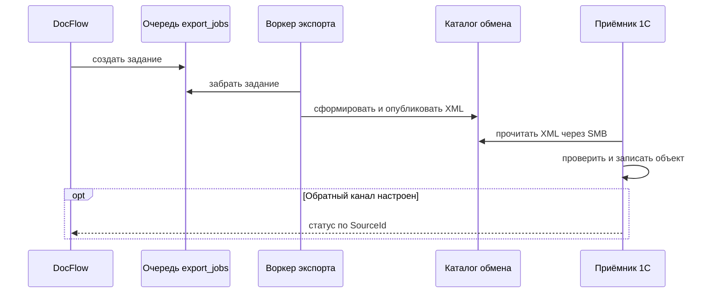

# Интеграция с 1С

DocFlow готовит данные и передаёт их транспортом, выбранным `ONEC_MODE`. Файловый режим сериализует XML в каталог обмена; предусмотрены также REST и отключённый режим. Код и настройки находятся в [`internal/onec`](../docflow/internal/onec) и [`internal/config`](../docflow/internal/config). Получение файла, сопоставление с объектами, запись и проведение в конкретной базе — ответственность принимающей стороны 1С. `exported` означает успешное выполнение экспортёра, а не подтверждение приёма или проведения в 1С; при `disabled` экспортёр возвращает успех без отправки.



## Содержимое и категории

[`file.go`](../docflow/internal/onec/file.go) формирует XML `Message` с `format="EnterpriseData/1.0"`: `SourceId`, `kind`, тип и необязательный `Target`, реквизиты, контрагент, компания, таблица/строки, `MissingFields` и дополнительные поля. Примеры — [`onec-samples`](../onec-samples); это контракт проекта, а не гарантия совместимости со всякой реализацией EnterpriseData. Соответствия объектам задаются реестром [`doctypes.json`](../doctypes.json) и настройкой приложения.

Внутренние `act`, `schet_faktura`, `act_priemki`, `invoice`, `receipt`, `payment_order`, `act_sverki` нормализуются в `act`; `waybill`, `contract`, `power_of_attorney`, `upd` остаются отдельными категориями. Это объединение для маршрутизации: соответствие каждого исходного вида бухгалтерскому объекту следует согласовать с 1С.

## Очередь и файловые профили

Воркер [`exporter.go`](../docflow/internal/worker/exporter.go) забирает `export_jobs`, формирует payload и повторяет ошибки с экспоненциальной задержкой до `ONEC_MAX_ATTEMPTS`. При успехе отмечает задание завершённым; `partial` оставляет документ в `needs_input`, полный экспорт или `update` переводит его в `exported`.

* `legacy`: каталог выбирается по очищенному имени папки компании либо используется корень `ONEC_FILE_DIR`. XML публикуется через временный скрытый файл и переименование. Политика маршрутизации учитывает настройки проверки, сопоставления и согласования.
* `type_inbox`: файловый режим обязателен. Каталог выбирается только по разрешённой категории; папка компании игнорируется. Имя `<SourceId>_<kind>.xml`; временный файл синхронизируется и публикуется атомарной жёсткой ссылкой. Одинаковый повтор считается успехом, отличающееся содержимое с тем же именем вызывает ошибку без перезаписи. Файловая система должна поддерживать эту операцию. Неизвестный тип, неподтверждённый владелец и тестовая учётная запись `golden_test` отклоняются. Детали — [`type_inbox_file.go`](../docflow/internal/onec/type_inbox_file.go) и [`type_inbox_export.go`](../docflow/internal/worker/type_inbox_export.go).

В `type_inbox` при включённой автовыгрузке допустимый тип может быть подтверждён даже при недостающих полях, ошибках или отсутствии маппинга. XML получает `incomplete` и список известных отсутствующих полей; несогласованные строки и таблица исключаются из XML. Безопасное поведение получателя для неполных данных необходимо согласовать и проверить. В `legacy` условия отличаются; частичная выгрузка зависит от `EXPORT_PARTIAL_ENABLED`. Виды заданий `create`, `partial`, `update` не являются статусами приёма 1С.

## Приёмник и обратная связь

Каталог backend может быть предоставлен рабочей станции через Samba/SMB; Samba, сетевые маршруты и ACL настраиваются вне Compose. Приёмнику нужны необходимые права чтения и, если он архивирует файлы, перемещения/записи; доступ по сети сам по себе не подтверждает эти права. Он должен игнорировать временные файлы, проверять XML и `Target`, обрабатывать неполные данные по согласованным правилам, сопоставлять повторные выгрузки по `SourceId` и надёжно архивировать обработанные файлы.

В репозитории есть каркас [`ЗагрузкаDocFlow.bsl`](../onec-receiver/ЗагрузкаDocFlow.bsl), а [`ONEC-INTEGRATION.md`](../ONEC-INTEGRATION.md) описывает предположения о конкретной конфигурации. Каркас требует адаптации и проверки в целевой базе; наличие кода не доказывает его установку и работу. В частности, обработка `update` до исходного документа и повторов должна проверяться вместе с фактической логикой архивирования.

Backend реализует `POST /api/onec/status` с отдельным токеном и принимает `accepted`, `posted`, `rejected`, `error`; `source_id` связывает ответ с документом. Архивация зависит от `ONEC_ARCHIVE_STATUSES`. Реализация API и BSL не подтверждает, что callback настроен и успешно проходит в реальной 1С.

Тесты кода проверяют нормализацию, формирование payload и публикацию файлов (см. [`internal/onec`](../docflow/internal/onec) и [`internal/worker`](../docflow/internal/worker)). При проверке `type_inbox` на шести документах пять XML появились в каталогах `act`, `waybill` и `contract`, а документ с типом `unknown` не был выгружен; все пять XML были помечены `incomplete=true`. Эта проверка не включала импорт в 1С. Сквозное создание и проведение объектов, все категории, обработка `incomplete`, повторы и обратные статусы в целевой 1С требуют отдельного подтверждения. Проверяйте эти этапы контрольным сценарием без предположения, что наличие XML означает успех импорта.

## Пример XML

Ниже вымышленные данные в форме, создаваемой сериализатором; пустые элементы без `omitempty` сохраняются. Доступность `Target`, `Company`, `Table`, `Accounting` и дополнительных полей зависит от данных и конфигурации. Обязательность для конкретной базы 1С определяется её контрактом, а не только наличием XML-элемента. Профили используют один сериализатор, но различаются проверками, выбором папки и обработкой неполноты.

```xml
<?xml version="1.0" encoding="UTF-8"?>
<Message format="EnterpriseData/1.0">
  <Body>
    <Document kind="create">
      <SourceId>11111111-2222-4333-8444-555555555555</SourceId>
      <Type>act</Type>
      <TypeTitle>Акт</TypeTitle>
      <Target object="Документ.ПолучениеУслуг" kind="document"></Target>
      <Number>TEST-1</Number>
      <Date>01.01.2026</Date>
      <Total>100.00</Total>
      <VATAmount></VATAmount>
      <Currency>BYN</Currency>
      <AmountNoVAT></AmountNoVAT>
      <ContractNumber></ContractNumber>
      <ContractDate></ContractDate>
      <Organization>Тестовая организация</Organization>
      <OrganizationUNP></OrganizationUNP>
      <Counterparty><Name>Тестовый поставщик</Name></Counterparty>
      <Lines></Lines>
      <MissingFields></MissingFields>
      <AdditionalFields></AdditionalFields>
    </Document>
  </Body>
</Message>
```

`Target` в примере соответствует типу `act` в [`doctypes.example.json`](../doctypes.example.json); реальные имена и реквизиты необходимо проверить в целевой конфигурации 1С. Это минимальная иллюстрация формата, а не комплект данных, достаточный для проведения. XML без `Target` также возможен, но каркас приёмника его отклоняет. В `type_inbox` ошибки реквизитов могут привести к `incomplete="true"`; `MissingFields` перечисляет известные пропуски и не обязательно описывает все причины неполноты. При несовпадении суммы строк этот профиль исключает позиции и таблицу из payload. `SourceId` стабилен для связывания разных видов выгрузки одного документа.

## Счета и бухгалтерская аналитика

Реестры [`accounts.json`](../accounts.json) и [`doctypes.json`](../doctypes.json) лежат в корне репозитория; подключаемые файлы определяются `ACCOUNTS_PATH` и `DOCTYPES_PATH`, а монтирования — Compose и runtime-конфигурацией. [`accounts.go`](../docflow/internal/recognize/accounts.go) загружает план счетов и правила. `ApplyAccounts` выполняется после извлечения и определения сторон, до окончательных проверок: для строки может использоваться счёт модели или первое подходящее правило по названию и типу; затем выбирается наиболее частый счёт строк, либо применяется fallback по содержанию и типу. Кредит и счёт НДС берутся по дебету, типу или настройке по умолчанию. При отсутствии загруженного справочника подбор отключён; пустые значения остаются на решение бухгалтера. Код проверяет допустимость счетов и не заменяет ручные значения автоматически.

XML может содержать счета `Accounting` и счета строк, а также контрагента, организацию и номер/дату договора. Это рекомендации и распознанные реквизиты, а не полный набор проводок. В конфигурации 1С конкретные счета могут требовать контрагента, договор, место хранения, материально ответственное лицо, статью затрат, объект ОС или сотрудника в соответствующих субконто. Обязательность, источники и допустимые значения зависят от счёта и конфигурации и должны быть согласованы бухгалтерией и реализованы приёмником. Ни успешное распознавание, ни готовый XML, ни найденный счёт не гарантируют создание или проведение объекта в 1С.

## Обратное уведомление

`POST /api/onec/status` принимает JSON с `source_id`, `status` и необязательными `ref`, `message`; аутентификация — заголовок `X-DocFlow-Token` или Bearer с настроенным `ONEC_INBOUND_TOKEN`. Пустой серверный токен закрывает канал. Пример тела с вымышленными значениями:

```json
{
  "source_id": "11111111-2222-4333-8444-555555555555",
  "status": "accepted",
  "ref": "Тестовый объект",
  "message": "Требуется проверка"
}
```

Обработчик проверяет UUID и одно из четырёх значений статуса, сохраняет результат по документу, пишет аудит и инициирует уведомление. Если статус входит в `ONEC_ARCHIVE_STATUSES`, он пытается архивировать документ; ответ содержит `archived`. Неверный токен даёт 401, неверное тело или статус — 400, неизвестный документ — 404. Доступность endpoint не доказывает настройку или доставку обратных уведомлений из 1С.

## Проверка обмена

| Этап | Ожидаемый результат | Способ проверки |
| --- | --- | --- |
| Загрузка и OCR | Документ и распознанные данные доступны уполномоченному пользователю | Карточка и журнал обработки на изолированном стенде |
| Подтверждение и очередь | Создано задание нужного вида | Статус документа и `export_jobs` |
| XML и доступ | XML опубликован в ожидаемом каталоге, доступен получателю | Проверить содержимое тестового файла и права SMB |
| Неполный документ | Признаки неполноты присутствуют; получатель не проводит данные без согласованной проверки | Контрольный XML и результат в тестовой 1С |
| Неизвестная категория | Автоматический маршрут `type_inbox` не публикует XML | Состояние и журнал на тестовом стенде |
| Повтор и изменение | Повтор не создаёт дубль; `update` корректно сопоставлен | Повторить импорт, проверить объект и архив в 1С |
| Ошибка приёмника | Ошибка видна, файл не считается успешно обработанным по согласованному процессу | Протокол приёмника и состояние файла |
| Нет обратного статуса | Отсутствие ответа не трактуется как доказательство успеха или неуспеха | Сверка результата в 1С и настройки callback |

Каркас BSL ищет XML в переданном каталоге без рекурсии, поэтому при папках категорий нужно отдельно настроить их обход. В случае `update` без исходного объекта функция возвращает строку с пояснением, но вызывающий код сравнивает её с точным значением `пропущен`, увеличивает счётчик загрузок и затем вызывает перенос в архив. Это потенциальная ошибка обработки досылки, установленная чтением кода; её последствия в установленной 1С и возможность повторной доставки не подтверждены. См. [`ЗагрузкаDocFlow.bsl`](../onec-receiver/ЗагрузкаDocFlow.bsl). Не считайте этот каркас доказанным рабочим приёмником.
